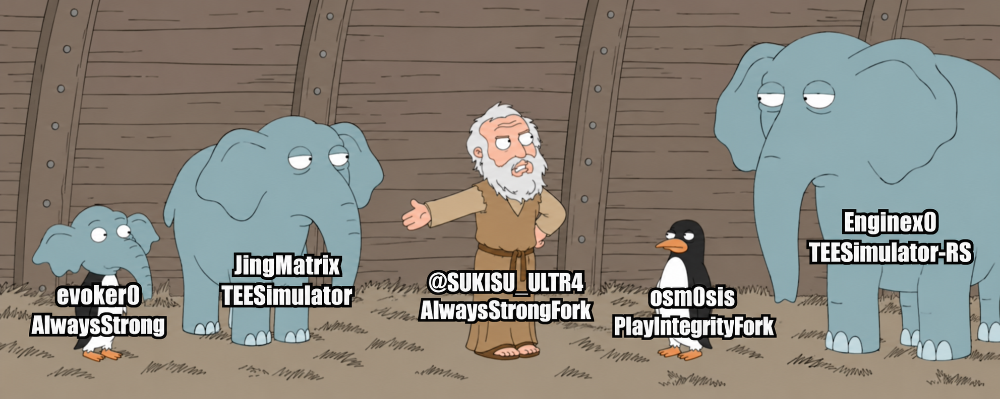

<div align="center">


# AlwaysStrongFork

**Play Integrity, keybox management, and recovery in one module.**

**Fork author: [@SUKISU_ULTR4](https://t.me/SUKISU_ULTR4)**

[](https://github.com/zaigraevstepan7-afk/Alwaysstrongfork/actions/workflows/build.yml)
[](https://github.com/zaigraevstepan7-afk/Alwaysstrongfork/releases/latest)
[](LICENSE)
[](#requirements)
[](https://t.me/alwaysstrongfork)

[**Download ZIP**](https://github.com/zaigraevstepan7-afk/Alwaysstrongfork/releases/latest) · [Installation](#installation) · [Check your results](#how-to-check-play-integrity) · [Support](#support)

</div>

AlwaysStrongFork is an AlwaysStrong fork based on Repair 1.3. The default build combines **TEESimulator-RS** and **PlayIntegrityFork**, updates the fingerprint, manages keyboxes, and recovers damaged local files. Settings are available through WebUI.

The module is intended for Play Integrity on rooted devices. **BASIC / DEVICE / STRONG** results come from an actual check on the device: having a keybox or successfully running Action does not by itself mean 3/3.

## Features

- **Two components in one module.** TEESimulator-RS handles hardware attestation; PlayIntegrityFork handles the fingerprint and related Google Play Services parameters.
- **Fingerprint updates.** Automatic Pixel fingerprint downloads, fallback sources, and custom `pif.json` / `pif.prop` imports.
- **Keybox management.** HTTPS downloads, XML / PEM / DER structure checks, complete backups, and atomic file replacement.
- **Recovery.** Restore a complete local backup when a keybox is damaged; a separate repair mode can run after importing a checker result.
- **Per-app settings.** Automatic target list updates, attestation modes, and keybox assignments for individual packages.
- **WebUI.** Light, dark, and system themes, interface translations, and settings for updates, spoofing, and security patches.
- **Consistent startup properties.** A bounded, verified boot/debug property policy runs before TEE startup and each owned daemon restart, covering existing OEM aliases without changing the device model.
- **Optional app hiding list.** Sync selected attestation targets to Magisk DenyList for use with a compatible external hider; enforcement stays under your control.
- **Background process controls.** Locks against concurrent writes, bounded startup operations, and protection against endless engine restarts.
- **Diagnostics.** Log collection and separate status indicators for keybox file health and imported Play Integrity verdicts.

## Requirements

| Component | Requirement |
| --- | --- |
| Android | Android 10 or later, SDK 29+. |
| Architecture | **ARM64** (`arm64-v8a`) or **ARMv7** (`armeabi-v7a`). |
| Root manager | Magisk, KernelSU, or APatch with module installation support. |
| Zygisk | The default and Inject variants require working Zygisk; KernelSU / APatch need a separate compatible implementation. |
| Internet | Required to download a new fingerprint or keybox. |
| WebUI | A compatible WebUI host with root access. |

**x86 / x86_64 are not supported by the current Repair build:** the required `asfetch` runtime is supplied only for ARM. Individual x86 libraries from upstream components do not remove this limitation.

## Choose a ZIP

[Releases](https://github.com/zaigraevstepan7-afk/Alwaysstrongfork/releases/latest) provide three variants of the same version. All use TEESimulator-RS and share the module ID `tricky_store`.

| Variant | Filename | Contents and purpose |
| --- | --- | --- |
| **Default** | `AlwaysStrong-<version>.zip` | PlayIntegrityFork + TEESimulator-RS. Start here. |
| **Inject** | `AlwaysStrong-<version>-inject.zip` | PlayIntegrityFix inject-s + TEESimulator-RS. An alternative PIF implementation. |
| **Lite** | `AlwaysStrong-<version>-nopif.zip` | TEESimulator-RS without bundled PIF or built-in fingerprint spoofing. For use with a separate fingerprint solution, or without one. |

Install **one variant at a time**. Release ZIPs are ready to install; do not extract them before selecting one in your root manager. Checksums are provided in `SHA256SUMS.txt`.

## Optional mount isolation companion

`AlwaysStrong-Isolation-<version>.zip` is a **separate experimental module**, not a fourth PIF variant. It adds a native Zygisk component without replacing the main module's PIF library. The initial selected package is Duck Detector; its WebUI accepts exact package names.

**Repair 1.4.3 fixes Action on Android mksh**, including the `row: inaccessible or not found` regression. The WebUI now includes an Action button with persistent live output, an eight-minute deadline, and distinct error/warning states. See [release notes](releases/v1.0.5-repair.1.4.3.md) and [Action architecture](docs/WEBUI_ACTION.md).

**Repair 1.4.2 removes font memory remapping.** The previous implementation could crash an app if a mapped file changed or became unreadable. Old `private-fonts=1` settings cannot re-enable it. Existing font paths may therefore remain visible.

The companion stays inactive during boot and only permits the documented per-process unmount request after Android completes boot and remains up for **120 seconds**. A readiness token must match the current boot ID; a missing/stale token, disable/remove marker, bad config or IPC timeout results in no action. The request/response share a 150 ms monotonic deadline after the provider returns a connection. Config opens reject FIFOs, symlinks and oversized/nonregular files. The provider's own `connectCompanion()` call is outside this deadline.

Requires Android 10+, ARM64/ARMv7, and a compatible **Zygisk API v5 provider** (Magisk 27000+ or a provider implementing the API). Google Play, Soter, system processes, root-granted UIDs, SDK sandbox UIDs, isolated UIDs and child zygotes are excluded. KernelSU/APatch behavior depends on the installed provider and is not device-verified.

Install through the root manager, reboot, wait for activation and fully restart a selected app. Disable the companion and reboot to remove its behavior. It does not hide installed packages, repair vendor Soter keys or guarantee any detector result.

See [boot safety review](docs/BOOT_SAFETY_REVIEW.md), [report analysis](docs/DETECTOR_REPORT.md) and [native component details](native/isolation/README.md).

## Installation

1. Download a ZIP from the [latest release](https://github.com/zaigraevstepan7-afk/Alwaysstrongfork/releases/latest).
2. For the default / Inject variant, make sure Zygisk is enabled and working.
3. Resolve conflicts with other PIF / TEE modules. The installer checks for standalone PlayIntegrityFix/Fork, TrickyStore, TEESimulator, playcurl, and certain property spoofing modules. An active conflict **stops installation** and must be resolved manually.
4. In your root manager, open **Modules → Install from storage** and select the ZIP.
5. Reboot the device.
6. Open the module settings through a compatible WebUI host. Use **Action** if you need to refresh the configuration manually.
7. Check the result in a separate Play Integrity Checker.

Recovery installation is not supported. To upgrade an existing Repair build, install the ZIP over it; there is no need to delete `/data/adb/tricky_store`.

### First launch and WebUI

The default ZIP does not include the upstream TEESimulator-RS demonstration keybox. If no complete local backup exists, import your own file through WebUI or use the module's download function.

On KernelSU / APatch, open WebUI through a compatible manager. Magisk requires a compatible WebUI host installed by the user. **Action does not install an APK automatically and does not open WebUI.**

Action refreshes targets, fetches the keybox and fingerprint according to the selected modes, applies settings, and restarts related Google Play Services / Play Store processes. Run a separate check afterward.

## How to check Play Integrity

1. Run a new check in Play Integrity Checker. The WebUI launch button targets `gr.nikolasspyr.integritycheck`.
2. Copy the **complete result JSON** from the checker.
3. Paste it into the result import field in WebUI.
4. The module saves BASIC / DEVICE / STRONG and the original check time.

Imports require a result from the **last 15 minutes**, containing `requestDetails.timestampMillis` and a `deviceIntegrity` object. Plain text, screenshots, or a list of checkmarks cannot replace the JSON.

Before import, the indicators show `?`. Saved results include a timestamp and become stale after 24 hours. They represent check history, not continuous measurement.

The parser accepts already decoded JSON: it does not decrypt a Google token or independently verify its authenticity. Use a trusted checker. **“Keybox file complete” describes file integrity; it does not confirm Google trust or a STRONG verdict.**

### Automatic repair

| Situation | Behavior |
| --- | --- |
| The current keybox is missing or damaged | Local backups are checked and a complete copy is restored if available. A file explicitly deleted by the user is not automatically restored. |
| A fresh 3/3 result is imported | No replacement is needed for that result. |
| A fresh result with missing verdicts is imported | If automatic repair is enabled, the module attempts to download and validate a candidate. |
| Download or candidate validation fails | The current file is preserved. |
| A replacement succeeds | Run the checker again; the module does not assign itself a new successful verdict. |

A network repair attempt is allowed at most once per result and no more than **once every 6 hours**. This mechanism does not replace a new Play Integrity check.

## Settings

Use WebUI for normal settings. Background fingerprint and keybox updates default to **3600 seconds**, with an allowed interval of **60–86400 seconds**.

| Setting | Behavior |
| --- | --- |
| Automatic fingerprint updates | Downloads a new PIF configuration. Importing a custom fingerprint disables its regular automatic replacement. |
| Automatic keybox checks | Downloads and validates a candidate; identical contents do not trigger replacement. |
| Custom keybox | Disables regular automatic downloads. **Automatic repair is a separate setting:** an imported failing verdict can still trigger replacement of a custom keybox. Disable automatic repair if you do not want that replacement. |
| Target apps | Manages packages, attestation modes, and assigned keyboxes. |
| Security patch and spoofing options | Adjust behavior for a particular ROM. Change an option only when you understand its purpose. |
| Reset settings | Restores defaults and runs Action. The current keybox, custom keybox mode, and per-app keybox assignments are preserved. |

On Magisk, the module can add Google Play and checker entries to DenyList when enforcement is disabled. It does not change **Enforce DenyList** itself; these additions are skipped when enforcement is enabled.

### Optional target hiding (Magisk)

In **WebUI → Advanced → Targeting**, enable **Sync targets to DenyList**, then run **Action**. This adds the main processes of apps in the current attestation target list, plus their currently running package-prefixed subprocesses. Target-list rebuilds repeat the sync. If automatic targeting is enabled, that list can include every user-installed app; turn automatic targeting off and curate targets when you need a narrower policy.

This option defaults to off and requires Magisk plus a compatible external hider that consumes DenyList with enforcement off. It does not hide root by itself. With **Enforce DenyList** on, synchronization is skipped to preserve Zygisk injection. KernelSU/APatch hiding lists are not changed.

Existing DenyList entries are preserved. Turning the option off stops future additions; it does not remove entries already added. Manage removals in Magisk. Apps using unrelated custom process names or isolated processes may need manual configuration.

### Startup property checks

Before starting an attestation engine, `boot_props.sh` applies a single session-only policy to existing lock, verified-boot, verity, warranty, debug, and build type/tag properties, including OEM aliases. Writes are read back. A failed or timed-out policy skips that new engine launch and records `alwaysstrong/logs/boot-props.log`. The supervisor repeats this check before each owned daemon restart; Action also reapplies the policy.

For a read-only policy check in a root shell:

```sh
sh /data/adb/modules/tricky_store/boot_props.sh check
```

These are property views, not hardware bootloader or AVB validation. The policy does not change the model, encryption state, partitions, or persistent property storage. Disable the module and reboot to restore ROM defaults. The bundled TEESimulator-RS libraries and DEX remain upstream v6.0.1-307; this release changes integration and startup policy, not the native TEE implementation.

### Data locations

| Path | Contents |
| --- | --- |
| `/data/adb/modules/tricky_store/` | Installed scripts, libraries, and WebUI. |
| `/data/adb/tricky_store/keybox.xml` | Active keybox. |
| `/data/adb/tricky_store/keybox.xml.good` | Complete recovery backup. |
| `/data/adb/tricky_store/alwaysstrong/` | Settings, state, keybox assignments, checker results, and logs. |
| `/data/adb/tricky_store/target.txt` | Attestation target list. |

## Troubleshooting

| Symptom | What to check |
| --- | --- |
| DEVICE / STRONG is missing | Working Zygisk, active conflicts, keybox health, source availability, and a fresh check result. File health does not indicate whether Google has revoked a key. |
| WebUI shows `?` | Import the complete, fresh checker JSON. Run a new check after replacing the keybox. |
| The installer reports a conflict | Resolve the named conflict manually and install again. The module does not automatically remove other modules. |
| Action did not refresh data | Read its output and logs. Check the network and custom keybox / fingerprint modes. |
| WebUI does not open | Check your WebUI host and its root access. After updating, fully close the old window and reopen it. |
| The module disabled itself after several boots | Check `alwaysstrong/boot-state`, `boot-safe`, and the logs. The guard disables this module after three boot attempts without a stable checkpoint. |
| The engine did not start and `boot-props.log` reports a mismatch | A property write failed or timed out; inspect the named property and root-manager compatibility. A skipped launch does not prove a successful attestation. |
| The engine stopped restarting until reboot | The supervisor pauses after three unconfirmed launches or repeated `keystore2` restarts; the launch budget survives supervisor crashes within the same boot. Investigate the logs. |

Use **Collect logs** in WebUI or run this command in a root shell:

```sh
sh /data/adb/modules/tricky_store/collect_logs.sh
```

The script prints the report path: usually `/sdcard/AlwaysStrong-log*.txt`, or the configuration directory if shared storage is unavailable. Reports exclude keybox private key contents but may include the target app list. Review the file before sharing it.

Uninstall through your root manager, then reboot. The uninstall script removes settings, state, and logs under `alwaysstrong/`; this differs from installing an update over the existing module.

## Builds and releases

### GitHub Actions

[Build AlwaysStrongFork](https://github.com/zaigraevstepan7-afk/Alwaysstrongfork/actions/workflows/build.yml) runs on pushes to `main`, pull requests, and manual dispatch:

1. Checks shell and JavaScript syntax.
2. Builds host `asfetch` and runs **64 Python + 6 Rust tests**.
3. Rebuilds Android `asfetch` and `aswatcher` from the checkout for ARM64 / ARMv7 with NDK r27c.
4. Builds the default, Inject, and Lite ZIPs, verifies their structure, builds the optional Zygisk isolation companion, and generates `SHA256SUMS.txt`.

After a successful `main` push build, the [Release](https://github.com/zaigraevstepan7-afk/Alwaysstrongfork/actions/workflows/release.yml) workflow publishes the version from `module/module.prop` with three main-module ZIPs, the optional experimental isolation companion, and checksums. For an already published version, it synchronizes the release title and notes while preserving the existing assets. To publish a new version, increment `version` and `versionCode` and add `releases/<version>.md`.

Test ZIPs are also available in the `AlwaysStrongFork-module-zip` artifact. **Extract the outer artifact archive**, then install one of the ZIPs inside. Actions artifacts are retained for 90 days; published installation files are available in Releases.

### Local builds

You need Bash, `curl` or `wget`, `zip`, `unzip`, Perl, and a SHA256 utility. The builder downloads pinned upstream components, overlays the project files, and creates ZIPs in `out/`.

```bash
bash build.sh --variant fork          # Default
bash build.sh --variant inject        # Inject
bash build.sh --variant nopif         # Lite
bash build.sh --variant fork,inject,nopif
```

After changing native sources, run `bash scripts/build-repair-native.sh` with Rust, Android targets, and `ANDROID_NDK_HOME` before local packaging. Release CI always rebuilds the ARM helpers from source. Scripts are in [`scripts/`](scripts/), with sources in [`native/`](native/). TrickyStoreOSS / JingMatrix TEESimulator engines remain available in the source as additional variants; they are not included in standard releases.

Verify the completed archives:

```bash
python3 scripts/verify-module-zip.py out/AlwaysStrong-v*.zip
(cd out && sha256sum -c SHA256SUMS.txt)
```

CI generates `SHA256SUMS.txt` automatically. For a local build, create it with `(cd out && sha256sum AlwaysStrong-*.zip > SHA256SUMS.txt)`.

## Authors and upstream components

<div align="center">

</div>

| Author | Contribution |
| --- | --- |
| **[@SUKISU_ULTR4](https://t.me/SUKISU_ULTR4)** | **AlwaysStrongFork author**, fork development and the Repair-based interface. GitHub: [zaigraevstepan7-afk](https://github.com/zaigraevstepan7-afk). |
| [Evokerr](https://gitlab.com/Evokerr/AlwaysStrong) | Original AlwaysStrong and component integration. |
| [JingMatrix](https://github.com/JingMatrix/TEESimulator) | Original TEESimulator. |
| [Enginex0](https://github.com/Enginex0/TEESimulator-RS) | TEESimulator-RS. |
| [osm0sis](https://github.com/osm0sis/PlayIntegrityFork) | PlayIntegrityFork. |

The project also uses work by **KOWX712** (PlayIntegrityFix inject-s), **chiteroman** (Play Integrity Fix), **5ec1cff** (TrickyStore), **beakthoven** (TrickyStoreOSS), **Displax**, **daboynb**, **LSPosed / LSPlt**, and **ring**. Upstream attribution and licenses are preserved.

## Support

- Fork channel: **[t.me/alwaysstrongfork](https://t.me/alwaysstrongfork)**.
- Bugs: [GitHub Issues](https://github.com/zaigraevstepan7-afk/Alwaysstrongfork/issues). Include the module version, Android / ROM, root manager, Zygisk implementation, and a reviewed diagnostic log.
- Repair details: [REPAIR.md](REPAIR.md), [REPAIR_REVIEW.md](REPAIR_REVIEW.md), and [WebUI 1.3 notes](RELEASE_1_3.md). These are historical documents; use this README for current installation and release instructions.

## Limitations and license

The module does not create a Google-trusted keybox, physically relock the bootloader, or guarantee root hiding from every app. Source availability, key revocation, changes to checks, and ROM differences affect the outcome. This fork does not restore Widevine L1.

Passing build tests does not replace boot and runtime testing on a specific Android device. CI does not install release ZIPs on a physical phone.

**GPL-3.0** — see [LICENSE](LICENSE). Third-party component licenses are available in their respective upstream projects.
